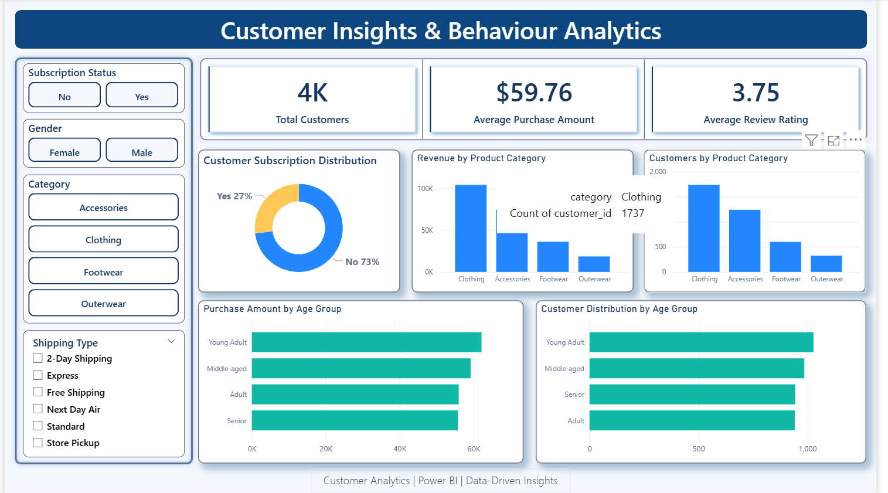

# 🛍️ Customer Shopping Behavior Analysis


An end-to-end data analytics project that turns retail transaction data into business insights using **Python, PostgreSQL and Power BI**.



---

## 📌 Table of Contents
- [Business Problem](#-business-problem)
- [Dataset](#-dataset)
- [Tools & Technologies](#-tools--technologies)
- [Project Workflow](#-project-workflow)
- [SQL Business Questions](#-sql-business-questions)
- [Power BI Dashboard](#-power-bi-dashboard)
- [Key Findings](#-key-findings)
- [Business Recommendations](#-business-recommendations)
- [Project Structure](#-project-structure)
- [How to Run](#-how-to-run)
- [Limitations & Future Work](#-limitations--future-work)
- [Author](#-author)

---

## 🎯 Business Problem

A retail business wants to understand how customers shop so it can make better decisions on marketing, discounts, subscriptions and retention.

**Core question:** *How can customer shopping data be used to identify patterns, improve engagement and support better-informed business decisions?*

---

## 📊 Dataset

| Attribute | Details |
|---|---|
| Records | 3,900 purchase records |
| Columns | 18 original columns |
| Customer data | Age, gender, location, subscription status |
| Purchase data | Item, category, purchase amount, season, size, colour |
| Behavior data | Discount applied, previous purchases, purchase frequency, review rating, shipping type |
| Missing values | 37 in `Review Rating` |

---

## 🛠️ Tools & Technologies

| Tool | Purpose |
|---|---|
| **Python (Pandas)** | Data inspection, cleaning and feature engineering |
| **PostgreSQL** | Storing the prepared data and answering business questions with SQL |
| **Power BI** | Interactive dashboard and reporting |
| **Jupyter Notebook** | Reproducible data preparation workflow |
| **SQLAlchemy** | Loading the DataFrame into PostgreSQL |

---

## 🔄 Project Workflow

```
Raw CSV  →  Python (clean + features)  →  PostgreSQL (10 SQL queries)  →  Power BI Dashboard
```

### 1. Data Cleaning & Preparation (Python)
- Loaded and inspected the dataset with `df.info()`, `df.describe()` and `df.isnull().sum()`
- Filled the **37 missing review ratings** using the **median rating within each product category**
- Standardized column names to lowercase with underscores
- Renamed `purchase_amount_(usd)` to `purchase_amount`

### 2. Feature Engineering
- **`age_group`**: four quantile-based groups (Young Adult, Adult, Middle-aged, Senior)
- **`purchase_frequency_days`**: purchase frequency labels mapped to approximate days (weekly = 7, bi-weekly = 14, monthly = 30, quarterly = 90, annually = 365)
- Dropped **`promo_code_used`** after confirming it duplicated `discount_applied`

### 3. Database Integration
- Loaded the prepared data into PostgreSQL as the table `customer_shopping_data`

### 4. SQL Analysis
- Answered 10 business questions (listed below)

### 5. Visualization
- Built an interactive Power BI dashboard with filters for subscription status, gender, category and shipping type

---

## ❓ SQL Business Questions

| # | Question |
|---|---|
| 1 | What is the total revenue generated by male vs. female customers? |
| 2 | Which customers used a discount but still spent more than the average purchase amount? |
| 3 | Which are the top 5 products with the highest average review rating? |
| 4 | How does the average purchase amount compare between Standard and Express shipping? |
| 5 | Do subscribed customers spend more? (average spend and total revenue) |
| 6 | Which 5 products have the highest percentage of purchases with a discount applied? |
| 7 | How many customers are New, Returning and Loyal? |
| 8 | What are the top 3 most purchased products within each category? |
| 9 | Are repeat buyers (more than 5 previous purchases) also likely to subscribe? |
| 10 | What is the revenue contribution of each age group? |

**Customer segment rules:**

| Segment | Previous purchases |
|---|---|
| New | 1 |
| Returning | 2 to 10 |
| Loyal | More than 10 |

SQL techniques used: aggregations, subqueries, CTEs, `CASE` statements and window functions (`ROW_NUMBER`).

---

## 📈 Power BI Dashboard

The dashboard, **Customer Insights & Behaviour Analytics**, includes:

- **KPI cards:** total customers, average purchase amount ($59.76), average review rating (3.75)
- **Subscription distribution:** 27% subscribed vs 73% not subscribed
- **Revenue and customers by product category**
- **Purchase amount and customer distribution by age group**
- **Slicers:** subscription status, gender, category and shipping type

> Open `dashboard/customer_behaviour_dashboard.pbix` in Power BI Desktop to explore it interactively.

---

## 🔍 Key Findings

> *Add your results here after running the SQL queries. Example format:*

- **Subscription:** Subscribers spend `X` on average vs `Y` for non-subscribers
- **Shipping:** Express vs Standard average purchase amount: `X` vs `Y`
- **Top categories:** `Category` generates the highest revenue
- **Loyalty:** `X%` of customers are in the Loyal segment
- **Discounts:** `Product` has the highest discount rate at `X%`

---

## 💡 Business Recommendations

- **Grow subscriptions:** promote subscriber benefits and track adoption and spend over time
- **Strengthen loyalty:** reward repeat buyers and track progress toward the Loyal segment
- **Review discount policy:** monitor high-discount products and weigh margin, not just revenue
- **Improve product positioning:** use ratings and purchase counts together when choosing campaign items
- **Target campaigns carefully:** tailor messages by age group and customer segment, not revenue totals alone
- **Evaluate shipping options:** compare Standard and Express spending without assuming cause and effect

---

## 📁 Project Structure

```
customer-shopping-behaviour-analysis/
├── dashboard/
    ├── customer_behaviour_dashboard.pbix
│   └── dashboard_preview.png 
├── data/
│   └── customer_shopping_behaviour.csv
├── presentation/
    └── Customer_Shopping_Behaviour_Presentation.pptx
├── report/
│   └── Customer_Shopping_Behaviour_Analysis_Project_Report.pdf
├── sql/
│   └── customer_behaviour_sql_queries.sql
├── .gitignore
├── Customer_Shopping_Behaviour_Analysis.ipynb
└── README.md
```

---

## ▶️ How to Run

**1. Clone the repository**
```bash
git clone https://github.com/<your-username>/customer-shopping-behavior-analysis.git
cd customer-shopping-behavior-analysis
```

**2. Install the requirements**
```bash
pip install pandas sqlalchemy psycopg2-binary jupyter
```

**3. Set up PostgreSQL**
- Create a database named `customer_behaviour`

**4. Run the notebook**
- Open `notebooks/Customer_Shopping_Behaviour_Analysis.ipynb`
- Replace `PASSWORD` in the connection string with your own PostgreSQL password
- Run all cells to clean the data and load the table `customer_shopping_data`

**5. Run the SQL queries**
- Open `sql/customer_behaviour_sql_queries.sql` in pgAdmin or psql and run the queries

**6. Explore the dashboard**
- Open `dashboard/customer_behaviour_dashboard.pbix` in Power BI Desktop

---

## ⚠️ Limitations & Future Work

- Check whether `customer_id` is unique per row, and use `COUNT(DISTINCT customer_id)` if unique-customer counts are needed
- Add profitability or margin data to evaluate discount-heavy products
- Validate that the Power BI measures match the SQL results
- Channel and payment preference fields are not in the dataset, so no conclusions are drawn about them

---

## 👤 Author

**Anand Shelake**

[](https://github.com/anandshelake-10)
[](https://www.linkedin.com/in/anand-shelake-33464922b)

⭐ If you found this project useful, please give it a star!
